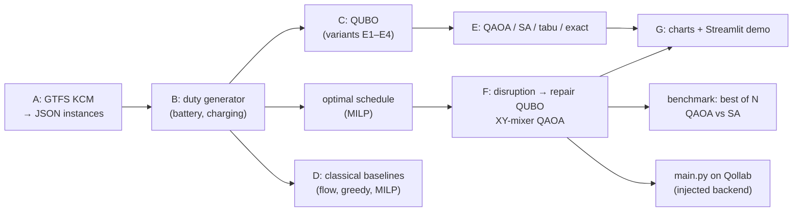

# Single-Depot Vehicle Scheduling Problem (VSP) for Electric Buses

Project documentation for the Qollab × IonQ quantum hackathon (October 9–11, 2026).
Repository: `github.com/KultanJuraj/E-buses-routing-problem` · License: MIT ·
*This effort is supported by Qollab & IonQ.*

The project solves the **Electric Vehicle Scheduling Problem** (E-VSP) on real public
transport data from King County Metro (Seattle). It covers two tasks:

1. **Daily schedule:** which bus drives which trips, and when and where it charges.
2. **Schedule repair after a disruption:** a bus or charger fails during the day and
   the trips must be reassigned quickly.

The combinatorial core is formulated as a **QUBO** and solved with **QAOA** in Qiskit.
For the repair we use **QAOA with an XY mixer**, which never leaves the set of valid
assignments. Every quantum result is compared with exact and heuristic classical methods.

---

## Contents

1. [Problem statement and why electric buses](#1-problem-statement-and-why-electric-buses)
2. [Architecture and status](#2-architecture-and-status)
3. [Installation and quick start](#3-installation-and-quick-start)
4. [Package A: data and instances](#4-package-a-data-and-instances)
5. [Package B: duty generator](#5-package-b-duty-generator)
6. [Package C: QUBO](#6-package-c-qubo)
7. [Package E: QAOA and classical comparison](#7-package-e-qaoa-and-classical-comparison)
8. [Package F: schedule repair after a disruption (XY mixer)](#8-package-f-schedule-repair-after-a-disruption-xy-mixer)
9. [Package G: visualization and demo](#9-package-g-visualization-and-demo)
10. [Package D: classical baselines](#10-package-d-classical-baselines)
11. [Solution-quality benchmark: best of N samples](#11-solution-quality-benchmark-best-of-n-samples)
12. [How QAOA scales: theory and measurements](#12-how-qaoa-scales-theory-and-measurements)
13. [Qollab submission (`main.py`)](#13-qollab-submission-mainpy)
14. [Quantum advantage: an honest assessment](#14-quantum-advantage-an-honest-assessment)
15. [Limitations and known issues](#15-limitations-and-known-issues)
16. [Repository structure and tests](#16-repository-structure-and-tests)
17. [Open items before submission](#17-open-items-before-submission)
18. [Work log](#18-work-log)
19. [References](#19-references)
20. [Glossary](#20-glossary)

---

## 1. Problem statement and why electric buses

The original assignment (iTranSys) contains three diesel scheduling scenarios:

| Scenario | Objective | Complexity |
|---|---|---|
| 1 | minimum number of vehicles | polynomial (minimum path cover / bipartite matching) |
| 2 | vehicles + deadhead kilometres | polynomial (minimum-cost flow) |
| 3 | deadhead km with at most `v_max` vehicles | polynomial (minimum-cost flow with a bounded depot arc) |

All three are in **P**. Package D solves them exactly: a 601-trip instance takes about 2 s.

We therefore chose the **electric bus extension (E-VSP)**. A limited battery,
charging during the day, a limited number of charger plugs and the peak grid load turn
the range limit into a route-length constraint, and that makes vehicle scheduling
**NP-hard** [1, 2]. Duty selection (set partitioning) is naturally written as a QUBO.

---

## 2. Architecture and status

The system is **hybrid**. Classical code prepares the data, generates battery-feasible
duties and checks every solution. The quantum part solves only the combinatorial core.



| Package | Content | Status |
|---|---|---|
| A | GTFS parser, instances, schema 1.0, validation | merged (PR #1) |
| B | battery-feasible duty generator, LP/MILP, qubit selection | merged (PR #2) |
| C | QUBO builder E1–E4, weight tuning, export to Qiskit and dimod | merged (PR #3, #4) |
| E | QAOA (exact simulator + Qiskit circuit), SA, metrics, noise | merged (PR #5) |
| F | disruption repair, XY mixer, event-time replay | merged (PR #6) |
| G | Plotly charts, Streamlit demo, figure export | merged (PR #7) |
| D | classical baselines, tabu search, classical-only QUBO benchmark | merged (PR #8) |
| Qollab | `main.py` entry point, MIT license | merged (PR #9) |
| Qollab | daily-schedule comparison in `main.py`, `--schedule-only` / `--repair-only`, JSON result log | merged (PR #10) |
| Benchmark | best of N samples, QAOA vs SA, charts | **to commit** |
| H | pitch deck (24 slides, `.pptx`) | done, outside the repo |

---

## 3. Installation and quick start

Python 3.11 or newer. Tested on 3.13 and 3.14, with Qiskit 2.3 and 2.5.

```sh
python -m pip install -r requirements.txt
python -m pytest -q                   # 178 tests, about 1.5 min
python main.py                        # Qollab entry point: daily-schedule comparison + one repair, ~4 min
python main.py --repair-only          # one repair, QAOA vs classical, ~5 s
python main.py --schedule-only        # daily-schedule comparison only
streamlit run app/demo.py             # interactive demo (Slovak UI)
python scripts/run_benchmark.py       # best-of-N benchmark + 3 charts, ~10 s
python scripts/run_classical.py       # classical baselines, ~50 s
```

`requirements.txt` pins numpy, pandas, jsonschema, scipy (LP/MILP through HiGHS),
qiskit 2.3.0, qiskit-optimization, dimod, qiskit-aer, plotly, streamlit and,
optionally, kaleido. Qollab needs only `requirements-qollab.txt`: qiskit, numpy, scipy
and matplotlib.

---

## 4. Package A: data and instances

**Source.** The King County Metro GTFS feed from February 2020, as distributed in
`dan-mccabe/beb-chargers-pactrans` (https://github.com/dan-mccabe/beb-chargers-pactrans) [9] (weekday `service_id 86021`; commit
`66cd683` was used). `evsp/data/gtfs_kcm.py` is specific to this feed. In it,
`shape_dist_traveled` is in feet. The upstream repository has no license file. The
underlying data is the public KCM GTFS feed and is credited as such.

| Instance | Trips | Selection |
|---|---:|---|
| `kcm_tiny` | 8 | route 150, at most 2 blocks |
| `kcm_small` | 20 | route 150, at most 5 blocks |
| `kcm_medium` | 133 | route 150, full day |
| `kcm_large` | 601 | all trips of blocks touching the study routes |

**Model assumptions.**

| Parameter | Value |
|---|---|
| battery | 419.4 kWh in the instance; `--battery 200` for the demo so that charging is required |
| consumption | 1.864 kWh/km |
| SoC | 10–100 %, start at 100 % |
| charging | 90 % efficiency, linear, at least 5 min |
| chargers | 7 stations S1–S7 with one 300 kW plug each, depot 10 × 150 kW (all **assumed**) |
| deadheads | great-circle × 1.3 at 30 km/h; 5 min minimum layover |
| tariff / costs | 0.20 day, 0.10 night (22–06) per kWh; vehicle 500, deadhead 1.5 per km |

`load_instance` validates against JSON schema 1.0 plus semantic checks.
`jsonschema` is optional: when it is missing, for example in a browser runtime, only
the schema step is skipped.

---

## 5. Package B: duty generator

`evsp/columns.py`, `scripts/build_columns.py`. A **duty (column)** is one bus for one
day: depot → trip → [deadhead | charge] → trip → … → depot. It is feasible if every
trip is reached in time and the SoC never drops below the minimum. For each duty the
generator precomputes:
- the cost c_k,
- the trip coverage a_ik,
- the deadhead km D_k,
- the energy per tariff slot,
- the power per station and slot,
- charger conflicts C and tight pairs r_kl.

The LP relaxation and the MILP (HiGHS) include exact charger capacity. Qubit selection
always keeps a complete feasible schedule. Every duty is replayed again before export.

| File | Duties | With charging | Qubits | Optimum |
|---|---:|---:|---:|---|
| `kcm_tiny_b20.json` | 50 | 0 | 20 | 2 buses, cost 1173.7 |
| `kcm_small_b20_bat200.json` | 991 | 971 | 20 | 5 buses, cost 3081.1, 7 charging stops, 450 kW peak |

---

## 6. Package C: QUBO

`evsp/qubo.py`. One binary variable y_k per selected duty:

$$
H(y)=\sum_k c_k y_k + P\sum_i\Big(\sum_k a_{ik}y_k-1\Big)^2 + Q\sum_{(k,l)\in C}y_ky_l + R\sum_t\Big(\sum_k p_{kt}y_k\Big)^2 + w_{rob}\sum_{k\neq l}r_{kl}y_ky_l + M\Big(\sum_k y_k-V\Big)^2
$$

The variants weight these terms differently:
- **E1:** vehicles, coverage, conflicts.
- **E2:** E1 plus deadhead and energy. This equals the MILP objective, which serves as a correctness check.
- **E3:** a fixed fleet size V.
- **E4:** E2 plus grid peak and robustness.

Penalties are set automatically: P = Q = 2 × the largest single-duty contribution.
`--normalize-costs` rescales the whole Hamiltonian. `--tune` grid-searches the weights
with brute force. The QUBO exports to Ising form, `SparsePauliOp`,
`QuadraticProgram` and a dimod BQM. `QUBO.energy` and `QUBO.evaluate` reject
non-binary or wrongly shaped bitstrings.

---

## 7. Package E: QAOA and classical comparison

`evsp/qaoa.py`, `evsp/solvers.py`, `scripts/run_qaoa.py`.

- **`FastQAOA`:** exact numpy statevector (complex64) on the diagonal cost
  Hamiltonian. `qaoa_circuit` is the same ansatz in Qiskit (RZ, RZZ, RX), and a test
  checks that both give identical probabilities.
- **Optimization:**
  - standardized Hamiltonian,
  - CVaR objective (α = 0.2) [14],
  - COBYLA or SPSA,
  - each depth starts from INTERP and from a zero-padded previous solution, so a larger
    depth never makes the result worse [18].
- **Classical solvers on the same QUBO:**
  - brute force (exact),
  - simulated annealing, which now also returns every run's final state,
  - multi-start tabu search with aspiration (added in the D review).
- **`run_qaoa.py --classical-only`:** benchmarks exact search, SA and tabu without
  QAOA. Every run also writes a CSV table with energy, feasibility, cost, vehicles,
  km, grid kWh, peak kW and time.

**Result** (daily-schedule QUBO, tiny, E2, 20 qubits, 32 feasible out of 2²⁰):

| method | P(optimum) | P(feasible) |
|---|---:|---:|
| random bitstring | 9.5·10⁻⁷ | – |
| penalty QAOA, p = 1 | 0.0003 (306× random) | 0.005 |
| simulated annealing, 100 runs | 0.12 | – |

The scaling run (8 → 20 qubits) shows P(optimum) falling from 0.26 to 0.0003 for
penalty QAOA and from 1.0 to 0.12 for SA. Textbook penalty QAOA is clearly worse than
SA here, which motivated package F.

**Daily-schedule comparison in `main.py`.** By default, `main.py` first compares all
methods on the bundled 20-duty pool (`columns/kcm_small_b20_bat200.json`, E4, R = 1)
before it runs the disruption repair:

| method | result |
|---|---|
| MILP (duty cost, without the E4 peak term) | cost 3,081.07, 5 buses, 0.3 s |
| exact QUBO search (E4) | energy 3,185.56 |
| simulated annealing, 200 runs | P(optimum) 0.150 |
| tabu search, 20 starts | best energy 3,185.56 (optimum) |
| QAOA, p = 2 | P(optimum) = P(feasible) = 0.0002 |

- The MILP objective omits the E4 peak term, so it is reported separately. Its
  selected schedule is also evaluated under E4 (`e4_evaluation`).
- With P(feasible) = 0.0002, 1,000 shots usually contain no feasible schedule, so the
  best raw QAOA sample is infeasible. Non-finite values (for example the best
  feasible energy when no feasible sample was seen) are saved as `null`.
- The full run takes about 4 minutes locally; almost all of it is the 20-qubit QAOA
  simulation. `--repair-only` skips this part (about 5 s); `--schedule-only` runs
  only this part.
- Both parts are saved to `results/main_bus_<bus>_<time>.json`:
  - `settings` (bus, time, shots, p_max),
  - `daily_schedule` (`milp`, `qubo_exact`, `simulated_annealing`, `tabu_search`,
    `qaoa`),
  - `disruption_repair` (`exact_repair`, `greedy`, `simulated_annealing`, `xy_qaoa`,
    `penalty_qaoa`, `backend_measurement` with the measured counts,
    `best_measured_repair`).

---

## 8. Package F: schedule repair after a disruption (XY mixer)

`evsp/disruption.py`, `evsp/xy_qaoa.py`, `scripts/run_repair.py`.

**Events.** `Disruption.bus_failure(schedule, "k4", 6*60)` and
`Disruption.charger_outage("S3", 7*60, 9*60)`.

**Model.** Every affected trip gets exactly one option: another bus (the
`max_bus_options` cheapest), a reserve bus R1–R3, or cancellation (cost 1500).

$$
H(z)=\sum_{t,o}c_{t,o}z_{t,o}+P\sum_t\Big(\sum_o z_{t,o}-1\Big)^2+Q\sum_{\text{conflicts}}z_{t,o}z_{t',o'}
$$

- **Costs.** $c_{t,o}$ is the true extra cost of inserting the trip: the bus's whole new
  day is replayed by `plan_duty`, with times, deadheads, battery and charging.
- **Conflicts.**
  - Two trips on the same bus conflict only if that pair cannot be replayed together.
    `one_trip_per_bus=True` is a conservative mode.
  - Options of different buses conflict if their charging would exceed the station's
    real connector count.
- **The past is never rewritten.** Plans start from the state at the event time: past
  charging is kept (`history`), and no new charge may start earlier (`not_before`).
  - A trip already in progress can only be cancelled.
  - A bus that cannot reach the depot tops up at the nearest free charger.
  - A bus whose duty cannot be replayed after a charger outage is "stranded". It
    hands over only the trips that have not started.
- **Validation.** `apply_assignment` replays the whole solution, including three or
  more trips on one bus and charger capacity. `best_valid_state` returns the
  cheapest one-hot state that passes this replay. `cancel_all_assignment` is the
  last-resort fallback.

**XY mixer** [12, 13]:

$$
H_{XY}=\sum_{\text{groups}}\sum_{(a,b)\in\text{ring}}\tfrac12(X_aX_b+Y_aY_b)
$$

The circuit starts from a product of W states and the mixer only moves the "1" inside
each trip's option group. The circuit never leaves the valid one-hot subspace (∏ $m_t$
states instead of 2ⁿ), so the one-hot penalty is not needed. `XYQAOA` simulates this
subspace exactly. `xy_qaoa_circuit` is the same ansatz in Qiskit (CRY+CX W-state,
RZ, RZZ, `XXPlusYYGate`).

**Results.** P(QUBO optimum) per shot, exact simulation:

| event | qubits | valid states | penalty QAOA | XY-QAOA | SA |
|---|---:|---:|---:|---:|---:|
| k585 fails 07:00 | 14 | 80 | 0.036 (valid 0.27) | **0.243** (valid 1.00) | 0.35 |
| k4 fails 06:00 | 20 | 480 | 0.0038 (valid 0.16) | **0.219** (valid 1.00) | 0.105 |
| S3 out 07:00–09:00 | 21 | 720 | – | **0.200** (valid 1.00) | 0.04 |

The repair for k4 at 06:00 cancels the 06:13 trip, which no bus can reach in time.
Two trips go to reserve R1 and two to bus k324, for an extra cost of 2,104. The S3
outage cancels nothing: buses charge at other stations.

---

## 9. Package G: visualization and demo

`evsp/viz.py`, `evsp/demo.py`, `app/demo.py`, `scripts/make_figures.py`.

**Streamlit app** (`streamlit run app/demo.py`):
- **Schedule:**
  - key figures,
  - Gantt chart with trips, deadheads, charging stations and pull-out/pull-in,
  - SoC of every bus, including charging after the last trip,
  - grid power per 15 min,
  - comparison of E4 with R = 0 and R > 0. On this pool both curves coincide,
    because the pool has a single feasible schedule.
  - duty table.
- **Disruption:**
  - choose a bus and time or a charger and window, then press **Break the bus** /
    **Switch off the charger**,
  - Gantt before and after the repair,
  - cost change and method comparison,
  - verdict on the XY-QAOA answer and circuit size.
- **Scaling:** penalty QAOA scaling from `results/*_scaling.json`.

**Live and precomputed results.** Penalty QAOA runs live up to 16 qubits. Larger
events use `results/repair_<event>.json` only if the event, trips, options, conflicts,
qubit count and subspace size all match the current model. Events with more than
100,000 valid states are refused.

**Figures.** `make_figures.py` exports HTML, and PNG with `--png` (needs kaleido and
Chrome). The colours come from a palette checked for colour-vision deficiency, and
every status also has a text label.

---

## 10. Package D: classical baselines

`evsp/classical_baselines.py`, `scripts/run_classical.py` → `results/baselines.json`.

- **Diesel S1–S3:** one minimum-cost flow model over the trip connection graph,
  solved as an LP. The matrix is totally unimodular, and the code checks that the
  solution is integral. S1 is cross-checked with Hopcroft–Karp matching. S3 returns a
  trade-off curve over `v_max`.
- **Real GTFS blocks:** measured with the same deadhead model. They are not a fair
  optimum to beat: they also serve routes outside the instance and follow
  constraints (drivers, garages) that we do not model.
- **Electric:**
  - `battery_check` replays the diesel optimum with a battery.
  - `greedy_electric` is a first-fit dispatcher: cheapest feasible insertion, greedy
    charging, capacity-aware. Its duties are valid package-B columns.
  - The exact reference is the MILP over all enumerated duties for tiny and small.
    For larger instances the diesel fleet is a lower bound.
- **Repair:**
  - `greedy_repair` gives each trip its cheapest option that still replays, in time order.
  - `exact_repair` replays every one-hot assignment and so finds the true-cost
    optimum, counting reserve activation once per bus.

| | tiny | small | medium | large |
|---|---:|---:|---:|---:|
| S1 = S2 buses (flow = matching) | 2 | 5 | 12 | 118 |
| S2 deadhead km | 71 | 176 | 454 | 5,107 |
| real GTFS blocks | 2 | 5 | 32 | 204 |
| diesel optimum battery-feasible (200 kWh) | 0/2 | 3/5 | 0/12 | – |
| greedy electric / exact MILP buses (200 kWh) | 4 / 3 | 7 / 5 | 21 / ≥ 12 | – |

On `large`, S3 deadhead falls from 5,107 to 4,889 km as `v_max` grows from 118 to 124.

**Repair, 38 bus failures** (5 buses × hourly 05:00–14:00):
- Greedy repair takes about 1 ms and equals the replayed QUBO optimum in all 38 events.
- Both reach the true-cost optimum in only 26 of 38 events.
- The gap (mean 21, max 74 cost units) comes from the pairwise QUBO model, which
  counts reserve activation per trip and treats insertion costs as additive.

---

## 11. Solution-quality benchmark: best of N samples

`evsp/benchmark.py`, `scripts/run_benchmark.py`, `scripts/plot_benchmark.py` →
`results/quality_benchmark.{json,csv}` and three PNG charts.

**Idea.** QAOA and SA are both samplers: one shot or one SA run gives one candidate
repair. A dispatcher takes N candidates, replays them and keeps the cheapest.

**Method.**
1. Every valid assignment is replayed once to get its **true** extra cost. A sample
   that is not a valid repair counts as the cancel-all fallback.
2. For each method, the cost distribution of one sample is built:
   - XY-QAOA and penalty QAOA from the exact statevector (penalty QAOA only for n ≤ 18),
   - SA from 2,000 independent runs,
   - random baselines: uniform over valid assignments and over all bitstrings.
3. The best-of-N statistics are computed exactly, without Monte Carlo noise (a test
   verifies them against Monte Carlo):

   $P(best\ of\ N = true\ optimum) = 1 − (1 − p_opt)^N$

   $E[cost\ of\ best\ of\ N]$ from $P(min ≥ v) = P(X ≥ v)^N$

**Samples needed to see the true optimum with 95 % confidence** (XY-QAOA p = 2 vs SA
with 500 sweeps vs random valid assignment):

| event | qubits | valid states | XY-QAOA | SA | random valid | penalty QAOA |
|---|---:|---:|---:|---:|---:|---:|
| k585 fails 07:00 | 14 | 80 | **39** | 60 | 79 | 351 |
| k190 fails 05:00 | 15 | 100 | 61 | **36** | 99 | 439 |
| k4 fails 06:00 | 20 | 480 | **35** | 96 | 478 | – |
| S3 out 07:00–09:00 | 21 | 720 | **69** | 170 | 718 | – |
| k585 fails 05:00 | 22 | 1,536 | **123** | 748 | 1,533 | – |

**Reading.**
- XY-QAOA needs fewer samples than SA in 4 of 5 events, and the lead grows with size.
- Penalty QAOA is far behind.
- The random valid assignment is a strong baseline for tiny subspaces, which shows how
  much the XY subspace itself contributes.

**Caveats.**
- One QAOA sample is one shot; one SA sample is a full 500-sweep run, which costs much
  more classically.
- QAOA is simulated ideally, without noise.
- The angle optimization is not counted.
- The exact optimum by full replay takes under a second at these sizes.

---

## 12. How QAOA scales: theory and measurements

| | penalty QAOA (X mixer) | XY-mixer QAOA | our runs, 14 → 22 qubits |
|---|---|---|---|
| qubits | n = Σ options per trip | n = Σ options per trip | 14 → 22 |
| states searched | 2ⁿ | ∏ m_t (valid only) | 80 → 1,536 |
| 2-qubit gates per layer | O(Σ m_t² + conflicts) | O(Σ m_t + conflicts) + W-state prep once | 44 → 78 vs 26 → 44 CX |
| parameters | 2p | 2p | p ≤ 3 |
| shots for 95 % | ln 20 / P(opt) | ln 20 / P(opt) | XY: 39 → 123 |
| classical simulation | 2ⁿ amplitudes | ∏ m_t amplitudes | XY simulable to about 60 qubits |

**Total CX count, p = 2, Qiskit transpile:**

| qubits | XY all-to-all | XY heavy-hex | penalty all-to-all | penalty heavy-hex |
|---:|---:|---:|---:|---:|
| 14 | 82 | 133 | 88 | 159 |
| 15 | 89 | 149 | 104 | 203 |
| 20 | 121 | 199 | 148 | 286 |
| 21 | 135 | 228 | 184 | 374 |
| 22 | 139 | 238 | 156 | 296 |

**Strengths.**
- Qubits and gates per layer grow polynomially, roughly linearly in the trip options.
- The XY mixer puts the constraints inside the circuit, which shrinks the search space.
- QAOA is a natural sampler that returns many candidates per run.
- It has few parameters, and they transfer between similar instances [18].
- Trapped-ion devices (IonQ) are all-to-all and need no SWAPs. Heavy-hex needs about
  1.7× more CX.

**Limits.**
- There is no proven speedup. Fixed-depth QAOA is provably limited on some problems,
  and p must grow with n [19].
- P(true optimum) per shot still decays: XY 0.074 → 0.024 from 14 to 22 qubits.
- Noise: the chance of an error-free run is about (1 − ε)^#CX. With an illustrative
  ε = 0.5 %, 139 CX give about 50 %. Noise also breaks the one-hot structure, so
  invalid shots must be post-selected.
- Angle tuning costs hundreds of circuit runs, and the landscape becomes flat for
  deep circuits [20].

---

## 13. Quantum advantage: an honest assessment

**We have no proven quantum advantage for this problem, and today nobody does.**
- Proven speedups (Grover, quantum branch-and-bound) need error correction, whose
  overhead removes the gain at practical sizes [15].
- Empirical scaling advantage for QAOA has been shown only on narrowly chosen
  problems [16].

**What the project shows:**
- The problem maps naturally to a QUBO.
- Circuit design matters more than QAOA itself. The XY mixer gives P(valid) = 1 and
  6–60× more optimal samples than penalty QAOA.
- In a sample budget, XY-QAOA needs fewer samples than SA in 4 of 5 repair events.
- Schedule repair is a small, urgent and repeated task that fits near-term hardware.
- The hybrid architecture lets the quantum part be swapped in as hardware matures.

---

## 14. Limitations and known issues

**Data**
- Chargers are assumed, not verified assets.
- Deadheads are estimates (`kcm_large` has 49 of 397 time-infeasible pairs in the real blocks).
- The depot is synthetic.

**Repair model**
- The QUBO counts reserve activation per trip, which is an upper bound. The QUBO
  optimum is the true optimum in only 26 of 38 events; full replay fixes the reported
  plan. A quadratic "reserve once" term is the next model improvement.
- `plan_duty` is a greedy charging planner, not an optimal one.
- Combinations of three or more trips on one bus are checked only by replay.

**Quantum part**
- Penalty QAOA uses a 2ⁿ statevector (n ≤ 22). The XY subspace is limited to
  5 million states, and the live demo to 100,000.
- All headline numbers come from noiseless simulation. A noisy Aer simulation exists,
  but no noisy best-of-N benchmark and no hardware run yet.
- The angle optimization cost is not included in the best-of-N comparison.

**Code**
- Tabu search defaults (20 starts × 500 steps) miss the optimum on `kcm_tiny` E2. With
  100 × 5,000 steps and tenure 8 it finds it.
- SPSA returns the last point, not the best one.
- `best_evals` in `qaoa.py` is unused.
- In the Streamlit app the hatched "cancelled" bar is faint. Fix: add `theme=None`
  to `st.plotly_chart`.

---

## 15. Repository structure and tests

```
main.py                    Qollab entry point (daily-schedule comparison, one repair, JSON log)
QOLLAB.md                  Qollab project page text (copied as README.md into the upload)
LICENSE                    MIT
requirements.txt           full environment; requirements-qollab.txt for Qollab
evsp/
  instance.py, validation.py, instance.schema.json, data/gtfs_kcm.py     package A
  columns.py                                                             package B
  qubo.py                                                                package C
  solvers.py (Landscape, SA with final states, tabu), qaoa.py            package E
  disruption.py, xy_qaoa.py                                              package F
  viz.py, demo.py                                                        package G
  classical_baselines.py                                                 package D
  benchmark.py                                                           best of N
app/demo.py                Streamlit demo
scripts/                   build_instances, validate_instances, build_columns, build_qubo,
                           run_qaoa (--classical-only, CSV), run_repair, make_figures,
                           run_classical, run_benchmark, plot_benchmark
tools/package_qollab.py    builds the Qollab upload
instances/ columns/ qubo/ results/ tests/
```

**Tests: 180 in total.**

| File | What it checks |
|---|---|
| `test_data`, `test_parser`, `test_validation` | parser, schema, energies, invalid inputs |
| `test_columns` | duty replay, LP/MILP, charger capacity, export safety |
| `test_qubo` | E2 = MILP, penalties, normalization, exports, binary validation |
| `test_qaoa` | FastQAOA = Qiskit, metrics, depth never hurts, SPSA, classical-only CLI and CSV |
| `test_disruption` | replay, conflicts, XY circuit = simulator, W states, XY > penalty, event-time history, in-progress trips, stranded bus, precomputed-JSON check, SoC after last trip |
| `test_viz` | charts, repair report, Streamlit AppTest |
| `test_classical` | flow = matching, S2/S3, integrality, greedy electric vs MILP, repair baselines |
| `test_benchmark` | best-of-N formulas, Monte Carlo agreement, true costs, XY P(valid) = 1 |
| `test_main` | result log of `main.py`, including runs where QAOA finds no feasible sample |

---

## 16. References

1. Bunte, S., Kliewer, N. (2009). An overview on vehicle scheduling models. *Public Transport* 1(4), 299–317.
2. Bertossi, A.A., Carraresi, P., Gallo, G. (1987). On some matching problems arising in vehicle scheduling models. *Networks* 17(3), 271–281.
3. Ribeiro, C.C., Soumis, F. (1994). A column generation approach to the multiple-depot vehicle scheduling problem. *Operations Research* 42(1), 41–52.
4. Löbel, A. (1998). Vehicle scheduling in public transit and Lagrangean pricing. *Management Science* 44(12), 1637–1649.
5. Wen, M., Linde, E., Ropke, S., Mirchandani, P., Larsen, A. (2016). An adaptive large neighborhood search heuristic for the Electric Vehicle Scheduling Problem. *Computers & Operations Research* 76, 73–83.
6. van Kooten Niekerk, M.E., van den Akker, J.M., Hoogeveen, J.A. (2017). Scheduling electric vehicles. *Public Transport* 9(1), 155–176.
7. Adler, J.D., Mirchandani, P.B. (2017). The vehicle scheduling problem for fleets with alternative-fuel vehicles. *Transportation Science* 51(2), 441–456.
8. Perumal, S.S.G., Lusby, R.M., Larsen, J. (2022). Electric bus planning & scheduling: A review of related problems and methodologies. *European Journal of Operational Research* 301(2), 395–413.
9. McCabe, D., Ban, X.J. (2023). Optimal locations and sizes of layover charging stations for electric buses. *Transportation Research Part C* 152, 104157.
10. Lucas, A. (2014). Ising formulations of many NP problems. *Frontiers in Physics* 2, 5.
11. Farhi, E., Goldstone, J., Gutmann, S. (2014). A quantum approximate optimization algorithm. arXiv:1411.4028.
12. Hadfield, S. et al. (2019). From the quantum approximate optimization algorithm to a quantum alternating operator ansatz. *Algorithms* 12(2), 34.
13. Wang, Z., Rubin, N.C., Dominy, J.M., Rieffel, E.G. (2020). XY mixers: Analytical and numerical results for the quantum alternating operator ansatz. *Physical Review A* 101, 012320.
14. Barkoutsos, P.K. et al. (2020). Improving variational quantum optimization using CVaR. *Quantum* 4, 256.
15. Babbush, R. et al. (2021). Focus beyond quadratic speedups for error-corrected quantum advantage. *PRX Quantum* 2, 010103.
16. Shaydulin, R. et al. (2024). Evidence of scaling advantage for the quantum approximate optimization algorithm on a classically intractable problem. *Science Advances* 10, eadm6761.
17. King County Metro. Zero-emissions fleet. kingcounty.gov (accessed October 2026).
18. Zhou, L., Wang, S.-T., Choi, S., Pichler, H., Lukin, M.D. (2020). Quantum approximate optimization algorithm: performance, mechanism, and implementation on near-term devices. *Physical Review X* 10, 021067.
19. Bravyi, S., Kliesch, A., Koenig, R., Tang, E. (2020). Obstacles to variational quantum optimization from symmetry protection. *Physical Review Letters* 125, 260505.
20. McClean, J.R. et al. (2018). Barren plateaus in quantum neural network training landscapes. *Nature Communications* 9, 4812.

---

## 17. Glossary

| Term | Meaning |
|---|---|
| trip | one run of a route from terminal to terminal at a given time |
| duty (column) | one bus for one day: trips, deadheads and charging stops |
| deadhead | a run without passengers |
| SoC | battery state of charge |
| QUBO | quadratic unconstrained binary optimization, min xᵀQx |
| QAOA | alternating cost and mixer layers with tuned angles γ, β |
| X mixer / XY mixer | ΣXᵢ explores all bitstrings / ½(XX+YY) moves a 1 inside a group |
| W state | uniform superposition of the states with exactly one 1 |
| CVaR | mean of the best fraction α of outcomes, used as the training objective |
| best of N | the cheapest of N sampled candidates after replay |
| true cost | cost after replaying the whole plan, with each reserve bus activated once |
| heavy-hex | IBM qubit topology; CX only between neighbours |